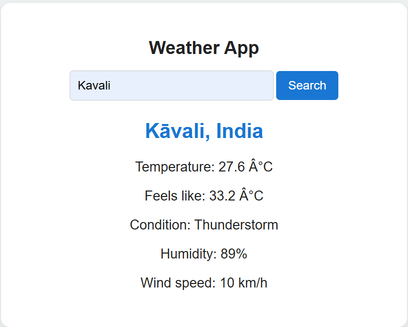

# Weather App

A responsive weather application built with HTML, CSS, and JavaScript. Search for a city to view its current weather information using the Open-Meteo API.

## Features

- Search weather by city name
- Press Enter or click Search to fetch weather
- Display temperature and feels-like temperature
- Show weather conditions, including rain, snow, fog, and thunderstorms
- Display humidity and wind speed
- Handle empty input and invalid city names
- Display an error message if a weather request fails
- No API key required

## Tech Stack

- HTML5
- CSS3
- JavaScript
- Fetch API
- Open-Meteo Geocoding API
- Open-Meteo Weather Forecast API

## Screenshot

## How to Run Locally

1. Clone or download this repository.
2. Open `index.html` in a browser.
3. Enter a city name and click Search or press Enter.

An internet connection is required to retrieve weather data.

## Live Demo

[Open the Weather App](https://RohithVelagapuram.github.io/weather-app/)

## API Attribution

Weather data provided by [Open-Meteo](https://open-meteo.com/).
